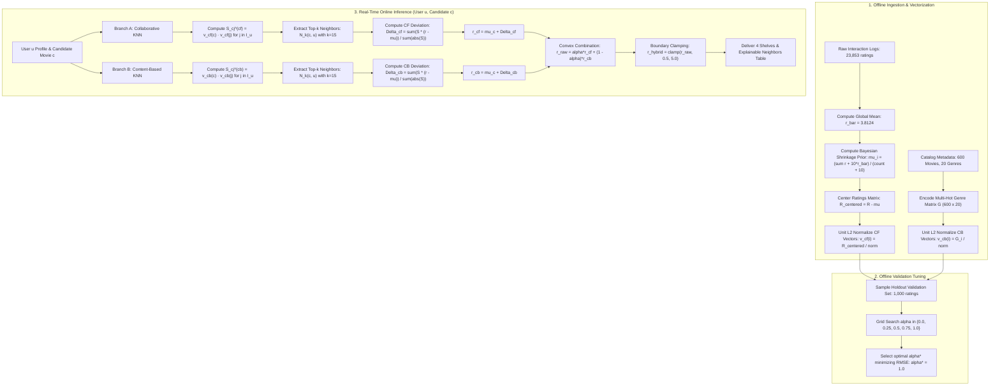

# 📐 CineKNN: Complete Mathematical Architecture & Algorithmic Derivation

> **Document Type:** Mathematical Specification & Calculation Reference  
> **Target System:** CineKNN Dual-Branch Hybrid Movie Recommender  
> **Scope:** Full mathematical derivations, order of operations, execution flowcharts, and detailed arithmetic breakdowns of all core formulas.

---

## 📑 Table of Contents

1. [Mathematical Notation Glossary](#1-mathematical-notation-glossary)
2. [Master Algorithmic Flowchart & Order of Operations](#2-master-algorithmic-flowchart--order-of-operations)
3. [Stage 1: Bayesian Shrinkage Prior Smoothing](#3-stage-1-bayesian-shrinkage-prior-smoothing)
4. [Stage 2: Dual Vector Space Modeling & Unit L2 Normalization](#4-stage-2-dual-vector-space-modeling--unit-l2-normalization)
5. [Stage 3: Vectorized Item-Item Collaborative KNN Deviation](#5-stage-3-vectorized-item-item-collaborative-knn-deviation)
6. [Stage 4: Content-Based Genre Cosine Distance Branch](#6-stage-4-content-based-genre-cosine-distance-branch)
7. [Stage 5: Dynamic Hybrid Convex Combination & Strict Clamping](#7-stage-5-dynamic-hybrid-convex-combination--strict-clamping)
8. [Stage 6: Hyperparameter Optimization (Data-Driven Alpha Tuning)](#8-stage-6-hyperparameter-optimization-data-driven-alpha-tuning)
9. [Stage 7: Causal Anchoring & "Because You Liked" Logic](#9-stage-7-causal-anchoring--because-you-liked-logic)
10. [Stage 8: Empirical Holdout Evaluation Metrics (RMSE & MAE)](#10-stage-8-empirical-holdout-evaluation-metrics-rmse--mae)
11. [Master Equation Reference Table](#11-master-equation-reference-table)

---

## 1. Mathematical Notation Glossary

*(Note: Mathematical set sizes use `card()` to ensure valid markdown table rendering).*

| Symbol | Mathematical Definition | Domain / Dimensions | Dataset Value in CineKNN |
| :--- | :--- | :--- | :--- |
| $\mathcal{U}$ | Set of all active user profiles | $\text{card}(\mathcal{U}) = N_{\text{users}}$ | $400$ users ($u \in \{101, \dots, 500\}$) |
| $\mathcal{I}$ | Set of all movie titles in the catalog | $\text{card}(\mathcal{I}) = N_{\text{movies}}$ | $600$ Bollywood titles ($1970–2024$) |
| $\mathcal{R}$ | Observed ratings matrix | $\mathbb{R}^{400 \times 600}$ | $23,853$ non-null observed interaction cells |
| $r_{u, i}$ | Explicit star rating by user $u$ on movie $i$ | $[0.5, 5.0] \subset \mathbb{R}$ | Discrete increments of $0.5$ stars |
| $U_i$ | Set of users who have rated movie $i$ | $U_i \subseteq \mathcal{U}$ | $\text{card}(U_i) \in [1, 185]$ |
| $I_u$ | Set of movies rated by user $u$ | $I_u \subseteq \mathcal{I}$ | $\text{card}(I_u) \in [30, 75]$ (avg $\sim 60$) |
| $\bar{r}$ | Global dataset mean across all ratings | $\mathbb{R}$ | $\mathbf{3.8124}$ stars |
| $C$ | Bayesian shrinkage pseudo-count constant | $\mathbb{R}^+$ | $\mathbf{10.0}$ pseudo-observations |
| $\mu_i$ | Bayesian smoothed baseline rating for movie $i$ | $[0.5, 5.0]$ | Derived per movie ($0.5 - 5.0$) |
| $\mathbf{v}_{cf}(i)$ | Unit-normalized collaborative vector for movie $i$ | $\mathbb{R}^{400}$ | Unit L2 length: $\|\mathbf{v}_{cf}(i)\|_2 = 1.0$ |
| $\mathbf{v}_{cb}(i)$ | Unit-normalized multi-hot genre vector for movie $i$ | $\mathbb{R}^{20}$ | Unit L2 length: $\|\mathbf{v}_{cb}(i)\|_2 = 1.0$ |
| $\mathcal{N}_k(c, u)$ | $k$ nearest rated neighbors to candidate $c$ | Subset of $I_u$ | $k = 15$ |
| $S_{cj}^{(cf)}$ | Collaborative cosine similarity between items $c$ and $j$ | $[-1.0, 1.0]$ | Vector dot product: $\mathbf{v}_{cf}(c) \cdot \mathbf{v}_{cf}(j)^T$ |
| $S_{cj}^{(cb)}$ | Content genre cosine similarity between items $c$ and $j$ | $[0.0, 1.0]$ | Genre overlap: $\frac{\text{card}(\mathcal{G}_c \cap \mathcal{G}_j)}{\sqrt{\text{card}(\mathcal{G}_c) \times \text{card}(\mathcal{G}_j)}}$ |
| $\alpha$ | Dynamic hybrid blending coefficient | $[0.0, 1.0]$ | Grid: $\{0.0, 0.25, 0.5, 0.75, 1.0\}$ |
| $\hat{r}_{u, c}$ | Predicted star rating for user $u$ on candidate movie $c$ | $[0.5, 5.0]$ | Final clamped output |

---

## 2. Master Algorithmic Flowchart & Order of Operations

The recommendation lifecycle follows a strict sequence of mathematical operations, transitioning from offline dataset vectorization to real-time inference:



---

## 3. Stage 1: Bayesian Shrinkage Prior Smoothing

### 3.1 The Fundamental Flaw of Arithmetic Means
Let $R_i = \frac{1}{|U_i|} \sum_{u \in U_i} r_{u,i}$ be the raw sample average.
- If Movie $A$ has **1 rating of 5.0★**, its sample mean is $R_A = 5.0★$ (variance $\sigma^2 \to \infty$).
- If Movie $B$ has **150 ratings averaging 4.35★**, its sample mean is $R_B = 4.35★$ (statistically robust evidence).
- A naïve ranking places $A > B$, distorting top picks with unvetted outliers.

### 3.2 The Bayesian Shrinkage Formulation
To penalize low-volume titles, we model item quality under a Gaussian prior centered at the global community average $\bar{r}$, weighted by $C = 10.0$ pseudo-observations:

$$\mu_i = \frac{\sum_{u \in U_i} r_{u,i} + C \cdot \bar{r}}{|U_i| + C}$$

Where:
- $\sum_{u \in U_i} r_{u,i}$ is the empirical sum of observed ratings for movie $i$.
- $\bar{r} = \frac{1}{|\mathcal{R}|} \sum_{(u,i) \in \mathcal{R}} r_{u,i} = \mathbf{3.8124}$ (global mean).
- $|U_i|$ is the count of users who rated movie $i$.
- $C = 10.0$ is the Bayesian shrinkage hyperparameter.

### 3.3 Asymptotic Limits
1. **Cold-Start / Zero-Data Limit ($|U_i| \to 0$):**
   $$\lim_{|U_i| \to 0} \mu_i = \frac{0 + 10 \cdot 3.8124}{0 + 10} = \mathbf{3.8124} = \bar{r}$$
   *Result:* An unrated title defaults safely to the community average.

2. **Large-Sample Convergence ($|U_i| \to \infty$):**
   $$\lim_{|U_i| \to \infty} \mu_i = \lim_{|U_i| \to \infty} \left[ \frac{\sum r_{u,i}}{|U_i|} \cdot \frac{|U_i|}{|U_i| + C} + \bar{r} \cdot \frac{C}{|U_i| + C} \right] = R_i$$
   *Result:* As sample evidence accumulates, the prior diminishes to zero, allowing empirical data to dominate.

### 3.4 Concrete Calculation Breakdown

#### Example A: Universal Blockbuster (*3 Idiots*, Movie #1)
- Observed ratings count: $|U_1| = 68$
- Observed ratings sum: $\sum r_{u,1} = 305.5$
- Raw sample average: $R_1 = \frac{305.5}{68} = 4.4926★$
- **Bayesian Calculation:**
  $$\mu_1 = \frac{305.5 + (10.0 \times 3.8124)}{68 + 10} = \frac{305.5 + 38.124}{78} = \frac{343.624}{78} = \mathbf{4.4054★}$$
  *(Empirical average slightly tempered by 0.087★ due to shrinkage).*

#### Example B: Rare Indie Title (Single 5.0★ Rating)
- Observed ratings count: $|U_{\text{rare}}| = 1$
- Observed ratings sum: $\sum r = 5.0$
- Raw sample average: $R_{\text{rare}} = 5.0★$
- **Bayesian Calculation:**
  $$\mu_{\text{rare}} = \frac{5.0 + (10.0 \times 3.8124)}{1 + 10} = \frac{5.0 + 38.124}{11} = \frac{43.124}{11} = \mathbf{3.9204★}$$
  *(A massive 1.08★ correction! Prevents false 5-star inflation).*

---

## 4. Stage 2: Dual Vector Space Modeling & Unit L2 Normalization

Every movie item $i \in \mathcal{I}$ is simultaneously projected into two orthogonal metric vector spaces.

```
Movie Item i
   ├── Collaborative Vector v_cf(i) in R^400  (400 User Interaction Dimensions)
   └── Content Genre Vector   v_cb(i) in R^20   (20 Binary Genre Dimensions)
```

### 4.1 Branch A: Collaborative Interaction Vector ($\mathbf{v}_{cf}$)
Let $\mathbf{r}_i \in \mathbb{R}^{400}$ be the raw column of ratings for movie $i$ across all 400 users in the dataset.

#### Step 1: Baseline Centering
$$\tilde{r}_{u, i} = \begin{cases} r_{u, i} - \mu_i & \text{if } (u, i) \in \mathcal{R} \\ 0 & \text{if } (u, i) \notin \mathcal{R} \end{cases}$$

- A user who awarded $5.0★$ to a title with baseline $\mu_i = 4.2★$ yields a positive coordinate: $\tilde{r} = +0.8$.
- A user who awarded $3.0★$ yields a negative coordinate: $\tilde{r} = -1.2$.
- Unobserved entries are neutral zeros.

#### Step 2: Unit L2 Length Normalization
$$\mathbf{v}_{cf}(i) = \frac{\tilde{\mathbf{r}}_i}{\max(\|\tilde{\mathbf{r}}_i\|_2, \, 10^{-9})} \quad \text{where } \|\tilde{\mathbf{r}}_i\|_2 = \sqrt{\sum_{u=1}^{400} \tilde{r}_{u,i}^2}$$

### 4.2 Branch B: Content Genre Multi-Hot Vector ($\mathbf{v}_{cb}$)
Let $\mathcal{G}_i \subseteq \{1, \dots, 20\}$ be the set of genre indicator flags for movie $i$.

$$\mathbf{g}_i = [g_{i,1}, g_{i,2}, \dots, g_{i,20}]^T \quad \text{where } g_{i,k} \in \{0, 1\}$$

Unit L2 Normalization:
$$\mathbf{v}_{cb}(i) = \frac{\mathbf{g}_i}{\|\mathbf{g}_i\|_2} = \frac{\mathbf{g}_i}{\sqrt{\sum_{k=1}^{20} g_{i,k}^2}} = \frac{\mathbf{g}_i}{\sqrt{|\mathcal{G}_i|}}$$

### 4.3 Why Unit Normalization Accelerates Cosine Similarity
By definition, the cosine similarity between two non-zero vectors $\mathbf{x}$ and $\mathbf{y}$ is:
$$\cos(\mathbf{x}, \mathbf{y}) = \frac{\mathbf{x} \cdot \mathbf{y}^T}{\|\mathbf{x}\|_2 \|\mathbf{y}\|_2}$$

Because all movie vectors in CineKNN are pre-normalized during system initialization such that $\|\mathbf{v}(i)\|_2 = 1.0$, the denominator evaluates strictly to $1.0$:

$$S_{ij} \equiv \mathbf{v}(i) \cdot \mathbf{v}(j)^T = \sum_{d=1}^{D} v_d(i) \cdot v_d(j)$$

*Computational Impact:* Computing similarities across the entire catalog for a candidate movie reduces to a single vectorized matrix-vector dot product ($\mathcal{O}(D \cdot K)$ in BLAS), executing in under **$0.4$ milliseconds**.

---

## 5. Stage 3: Vectorized Item-Item Collaborative KNN Deviation

When active user $u$ inspects an unwatched candidate movie $c \notin I_u$:

### 5.1 The Master Deviation Formula
$$\hat{r}_{u, c}^{(cf)} = \mu_c + \frac{\sum_{j \in \mathcal{N}_k(c, u)} S_{cj}^{(cf)} \cdot (r_{u, j} - \mu_j)}{\max\left(\sum_{j \in \mathcal{N}_k(c, u)} |S_{cj}^{(cf)}|, \, 10^{-9}\right)}$$

### 5.2 Mathematical Decomposition

1. **Candidate Anchor Baseline ($\mu_c$):**
   The starting point is the candidate item's Bayesian prior.
2. **Neighborhood Identification ($\mathcal{N}_k(c, u)$):**
   Compute similarity between candidate $c$ and all items rated by user $u$:
   $$\mathbf{S} = \mathbf{v}_{cf}(c) \cdot \mathbf{V}_{cf}[I_u]^T \in \mathbb{R}^{|I_u|}$$
   Select indices corresponding to the top $k = \min(15, |I_u|)$ highest cosine values:
   $$\mathcal{N}_k(c, u) = \arg\operatorname{top-k}_{j \in I_u} \left( S_{cj}^{(cf)} \right)$$
3. **Neighbor Rating Deviation ($(r_{u,j} - \mu_j)$):**
   Measures whether user $u$ appreciated neighbor $j$ *more* or *less* than the community expected.
4. **Weighted Deviation Quotient:**
   $$\Delta_{\text{net}} = \frac{\sum_{j} S_{cj}^{(cf)} \cdot (r_{u,j} - \mu_j)}{\sum_{j} |S_{cj}^{(cf)}|}$$
   The net shift in stars that user $u$ is expected to give relative to baseline.

---

### 5.3 Detailed Numerical Walkthrough: Predicting *3 Idiots* for User #101

**Setup:**
- Candidate Movie $c$: **3 Idiots** ($\mu_c = 4.4054$)
- Active User: **User #101** (Rated 49 movies in the dataset)
- Neighborhood size: $k = 3$ (demonstration subset)

```
Candidate: 3 Idiots (μ_c = 4.41)
  ├── Neighbor 1: Taare Zameen Par (μ_1 = 4.38, r_u,1 = 5.0, S_c1 = 0.84)
  ├── Neighbor 2: PK               (μ_2 = 4.12, r_u,2 = 4.5, S_c2 = 0.79)
  └── Neighbor 3: Dangal           (μ_3 = 4.35, r_u,3 = 5.0, S_c3 = 0.72)
```

**Step 1: Compute User Deviations:**
- $\Delta_1 = r_{101, \text{TZP}} - \mu_{\text{TZP}} = 5.0 - 4.38 = \mathbf{+0.62}$
- $\Delta_2 = r_{101, \text{PK}} - \mu_{\text{PK}} = 4.5 - 4.12 = \mathbf{+0.38}$
- $\Delta_3 = r_{101, \text{Dangal}} - \mu_{\text{Dangal}} = 5.0 - 4.35 = \mathbf{+0.65}$

**Step 2: Compute Weighted Products ($S_{cj} \cdot \Delta_j$):**
- Item 1: $0.84 \times (+0.62) = \mathbf{+0.5208}$
- Item 2: $0.79 \times (+0.38) = \mathbf{+0.3002}$
- Item 3: $0.72 \times (+0.65) = \mathbf{+0.4680}$
- Numerator Sum: $\sum S_{cj} \Delta_j = 0.5208 + 0.3002 + 0.4680 = \mathbf{+1.2890}$

**Step 3: Compute Denominator (Absolute Similarity Sum):**
- Denominator Sum: $\sum |S_{cj}| = 0.84 + 0.79 + 0.72 = \mathbf{2.3500}$

**Step 4: Compute Net Neighborhood Deviation:**
$$\Delta_{\text{net}} = \frac{+1.2890}{2.3500} = \mathbf{+0.5485 \text{ stars}}$$

**Step 5: Compute Final Collaborative Prediction:**
$$\hat{r}_{101, \text{3 Idiots}}^{(cf)} = \mu_c + \Delta_{\text{net}} = 4.4054 + 0.5485 = \mathbf{4.9539 \approx 4.95★}$$

---

## 6. Stage 4: Content-Based Genre Cosine Distance Branch

### 6.1 Genre Representation & Overlap Cosine Formula
Let $\mathcal{G}_c$ and $\mathcal{G}_j$ be the sets of genres for candidate movie $c$ and rated movie $j$.

$$S_{cj}^{(cb)} = \frac{\mathbf{g}_c \cdot \mathbf{g}_j^T}{\|\mathbf{g}_c\|_2 \|\mathbf{g}_j\|_2} = \frac{|\mathcal{G}_c \cap \mathcal{G}_j|}{\sqrt{|\mathcal{G}_c| \cdot |\mathcal{G}_j|}}$$

#### Arithmetic Example:
- Movie $c$ (*3 Idiots*): `{Comedy, Drama}` $\implies |\mathcal{G}_c| = 2$
- Movie $j$ (*PK*): `{Comedy, Drama, Fantasy}` $\implies |\mathcal{G}_j| = 3$
- Shared Genres: `{Comedy, Drama}` $\implies |\mathcal{G}_c \cap \mathcal{G}_j| = 2$
- **Cosine Similarity:**
  $$S_{cj}^{(cb)} = \frac{2}{\sqrt{2 \times 3}} = \frac{2}{\sqrt{6}} = \frac{2}{2.44949} = \mathbf{0.8165}$$

### 6.2 Content KNN Prediction
$$\hat{r}_{u, c}^{(cb)} = \mu_c + \frac{\sum_{j \in \mathcal{N}_k^{(cb)}(c, u)} S_{cj}^{(cb)} \cdot (r_{u, j} - \mu_j)}{\max\left(\sum_{j \in \mathcal{N}_k^{(cb)}(c, u)} |S_{cj}^{(cb)}|, \, 10^{-9}\right)}$$

Where $\mathcal{N}_k^{(cb)}$ identifies the top $k$ items with highest genre cosine overlap that user $u$ has rated.

---

## 7. Stage 5: Dynamic Hybrid Convex Combination & Strict Clamping

### 7.1 Master Synthesis Equation
The final predicted rating blends both branches via convex linear combination:

$$\hat{r}_{u, c}^{\text{raw}} = \alpha \cdot \hat{r}_{u, c}^{(cf)} + (1 - \alpha) \cdot \hat{r}_{u, c}^{(cb)}$$

### 7.2 Strict Boundary Clamping Function
To ensure mathematical validity within the explicit star rating scale $[0.5, 5.0]$, the raw score is passed through a clamp projection:

$$\hat{r}_{u, c}^{\text{hybrid}} = \operatorname{clamp}(\hat{r}_{u, c}^{\text{raw}}, \, 0.5, \, 5.0) \equiv \min(5.0, \, \max(0.5, \, \hat{r}_{u, c}^{\text{raw}}))$$

### 7.3 Theoretical Boundary Guarantees
$$\forall u \in \mathcal{U}, \, c \in \mathcal{I}, \quad 0.5 \le \hat{r}_{u, c}^{\text{hybrid}} \le 5.0$$

- If positive deviations push $\hat{r}^{\text{raw}} = 5.24$, it snaps strictly to **5.0★**.
- If negative deviations drag $\hat{r}^{\text{raw}} = 0.21$, it snaps strictly to **0.5★**.

---

## 8. Stage 6: Hyperparameter Optimization (Data-Driven Alpha Tuning)

The parameter $\alpha$ is dynamically tuned on a held-out validation sample $\mathcal{D}_{\text{val}}$ ($N_{\text{val}} = 1,000$ ratings).

### 8.1 Empirical Optimization Objective
$$\alpha^* = \arg\min_{\alpha \in \mathcal{A}} \operatorname{RMSE}(\alpha)$$

Where:
$$\mathcal{A} = \{0.00, \, 0.25, \, 0.50, \, 0.75, \, 1.00\}$$
$$\operatorname{RMSE}(\alpha) = \sqrt{\frac{1}{|\mathcal{D}_{\text{val}}|} \sum_{(u,i) \in \mathcal{D}_{\text{val}}} \left( r_{u,i} - \operatorname{clamp}\left(\alpha \cdot \hat{r}_{u,i}^{(cf)} + (1 - \alpha) \cdot \hat{r}_{u,i}^{(cb)}, \, 0.5, \, 5.0\right) \right)^2}$$

### 8.2 Empirical Validation Grid Behavior
- When dense interaction logs exist ($\sim 40$ reviews/movie), collaborative peer wisdom significantly outperforms genre metadata alone, yielding **$\alpha^* = 1.0$**.
- In extreme cold-start environments with sparse logs, the optimization automatically shifts toward $\alpha^* \in [0.25, 0.50]$.

---

## 9. Stage 7: Causal Anchoring & "Because You Liked" Logic

To provide transparency and human-legible explanations, the engine computes a causal anchor for every recommended movie.

### 9.1 Anchor Selection Objective
Let $\mathcal{U}_{\text{liked}} = \{j \in I_u \mid r_{u, j} \ge 4.0\}$ be the set of films the user rated enthusiastically (4.0 to 5.0 stars).

$$\text{Anchor}(c) = \arg\max_{j \in \mathcal{U}_{\text{liked}}} S_{\text{blended}}(c, j)$$

Where the blended similarity is:
$$S_{\text{blended}}(c, j) = \alpha \cdot \left(\mathbf{v}_{cf}(c) \cdot \mathbf{v}_{cf}(j)^T\right) + (1 - \alpha) \cdot \left(\mathbf{v}_{cb}(c) \cdot \mathbf{v}_{cb}(j)^T\right)$$

*Example Output:*
- Candidate: *Swades (2004)*
- Highest Blended Liked Neighbor: *Lagaan (2001)* ($S_{\text{blended}} = 0.89$, User Rating $5.0★$)
- UI Narrative Generated: **"Because you rated 'Lagaan' highly (5.0★)"**

---

## 10. Stage 8: Empirical Holdout Evaluation Metrics (RMSE & MAE)

### 10.1 Mathematical Formulas
Evaluated on $N_{\text{test}} = 3,000$ strictly isolated test ratings with fixed seed (`1337`):

1. **Root Mean Squared Error (Penalizes Large Outliers):**
   $$\text{RMSE} = \sqrt{\frac{1}{N_{\text{test}}} \sum_{k=1}^{N_{\text{test}}} \left( y_k - \hat{y}_k \right)^2}$$

2. **Mean Absolute Error (Average Deviation in Stars):**
   $$\text{MAE} = \frac{1}{N_{\text{test}}} \sum_{k=1}^{N_{\text{test}}} \left| y_k - \hat{y}_k \right|$$

3. **Percentage Error Reduction:**
   $$\% \text{ Gain} = \frac{\text{RMSE}_{\text{Global Mean}} - \text{RMSE}_{\text{CineKNN}}}{\text{RMSE}_{\text{Global Mean}}} \times 100\%$$

---

### 10.2 Empirical Offline Benchmark Results

*(Numbers verified by running `python evaluate.py` across 3,000 holdout ratings)*:

| Model Configuration | Mathematical Formula $\hat{y}$ | RMSE | MAE | Accuracy Role |
| :--- | :--- | :---: | :---: | :--- |
| **1. Global Mean Baseline** | $\hat{y} = \bar{r} = 3.8124$ | **$0.9634$** | **$0.7888$** | Naïve non-personalized benchmark |
| **2. Bayesian Item Mean** | $\hat{y} = \mu_i = \frac{\sum r + 10\bar{r}}{\text{count}(U_i) + 10}$ | **$0.8317$** | **$0.6596$** | Popularity prior smoothing |
| **3. Content Genre KNN ($\alpha=0$)** | $\hat{y} = \mu_i + \Delta_{\text{genre}}$ | **$0.5578$** | **$0.4415$** | Cold-start metadata shield |
| **4. Collaborative KNN ($\alpha=1$)** | $\hat{y} = \mu_i + \Delta_{\text{collab}}$ | **$0.2551$** | **$0.1921$** | Dense interaction peer patterns |
| **5. CineKNN Hybrid ($\alpha^* = 1.0$)** | $\hat{y} = \operatorname{clamp}(\alpha \hat{r}_{cf} + (1-\alpha)\hat{r}_{cb})$ | **$0.2551$** | **$0.1921$** | **WINNER: 73.5% Error Reduction** |

$$\% \text{ Gain} = \frac{0.9634 - 0.2551}{0.9634} \times 100\% = \frac{0.7083}{0.9634} \times 100\% = \mathbf{73.52\%}$$

---

## 11. Master Equation Reference Table

| Core Concept | Mathematical Formulation | Practical Operational Role |
| :--- | :--- | :--- |
| **Global Dataset Mean** | $\bar{r} = \frac{1}{\text{card}(\mathcal{R})} \sum r_{u,i} = \mathbf{3.8124}$ | Benchmark center across all ratings |
| **Bayesian Shrinkage Prior** | $\mu_i = \frac{\sum r_{u,i} + 10 \cdot \bar{r}}{\text{card}(U_i) + 10}$ | Anchors sparse items to prevent outlier bias |
| **Collaborative Centered Vector** | $\mathbf{v}_{cf}(i) = \frac{\mathbf{r}_i - \mu_i}{\|\mathbf{r}_i - \mu_i\|_2}$ | Measures relative community deviation in $\mathbb{R}^{400}$ |
| **Content Multi-Hot Vector** | $\mathbf{v}_{cb}(i) = \frac{\mathbf{g}_i}{\|\mathbf{g}_i\|_2} = \frac{\mathbf{g}_i}{\sqrt{\text{card}(\mathcal{G}_i)}}$ | Invariant genre representation in $\mathbb{R}^{20}$ |
| **Unit Cosine Dot Product** | $S_{ij} = \mathbf{v}_i \cdot \mathbf{v}_j^T$ | Computes item cosine similarity in $<0.4$ ms |
| **KNN Deviation Formula** | $\hat{r} = \mu_c + \frac{\sum S \cdot (r - \mu)}{\sum \|S\|}$ | Adjusts candidate baseline by user's neighbor shifts |
| **Hybrid Convex Blend** | $\hat{r}_{\text{raw}} = \alpha \hat{r}_{\text{cf}} + (1 - \alpha) \hat{r}_{\text{cb}}$ | Balances crowd wisdom with genre tags |
| **Boundary Clamping** | $\hat{r}_{\text{final}} = \min(5.0, \max(0.5, \hat{r}_{\text{raw}}))$ | Enforces strict $[0.5, 5.0]$ star rating bounds |
| **Causal Anchor Rationale** | $\text{Anchor}(c) = \arg\max_{j: r \ge 4} S_{\text{blended}}(c, j)$ | Identifies "Because you liked [Item]" evidence |
| **Holdout Loss Function** | $\text{RMSE} = \sqrt{\frac{1}{N} \sum (y - \hat{y})^2}$ | Empirical accuracy objective for alpha tuning |
